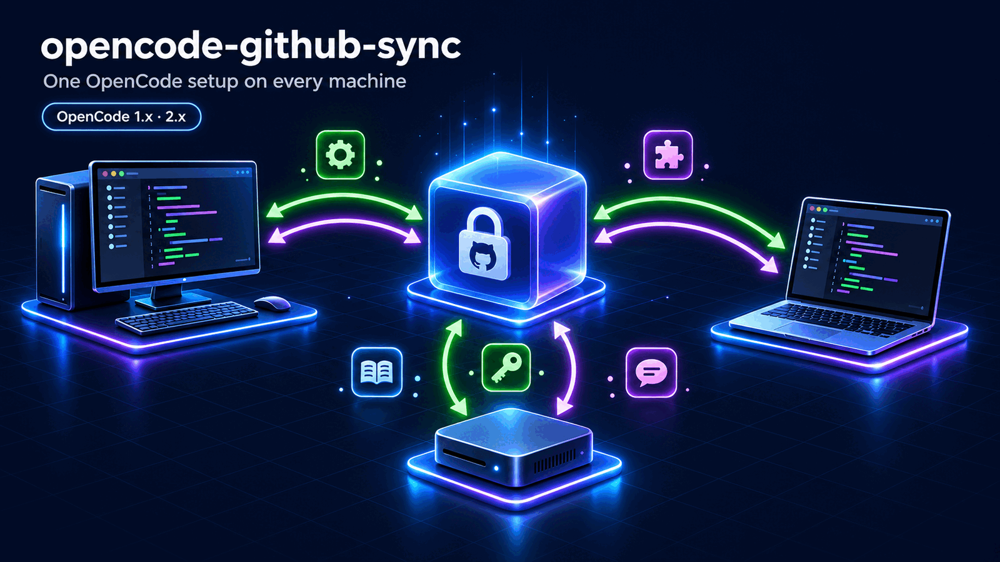
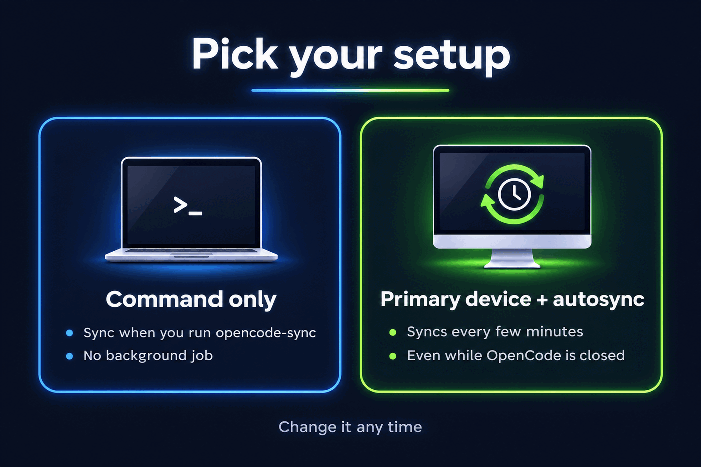
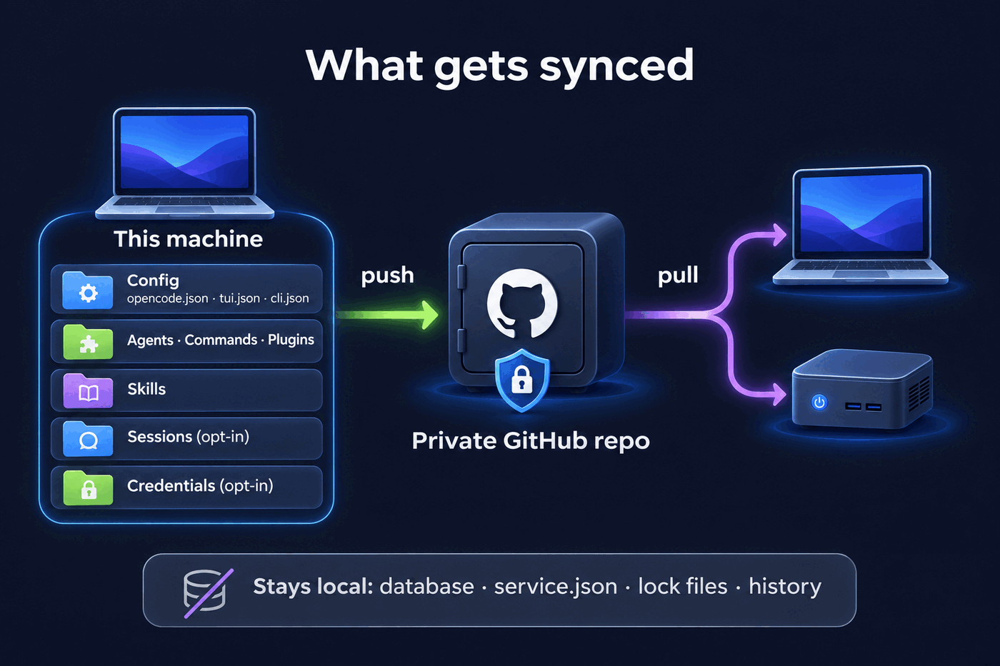
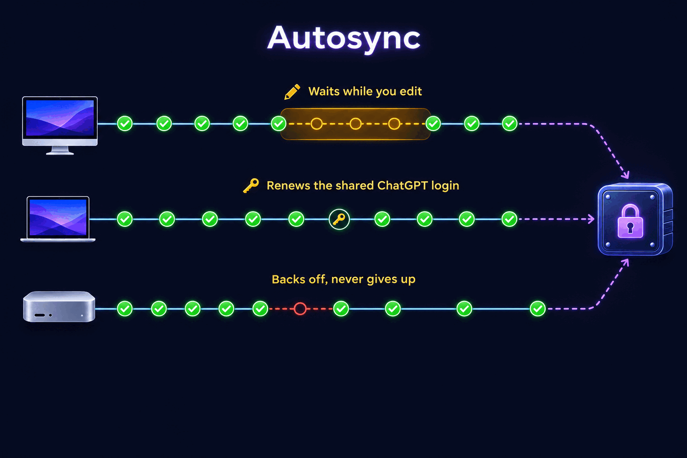
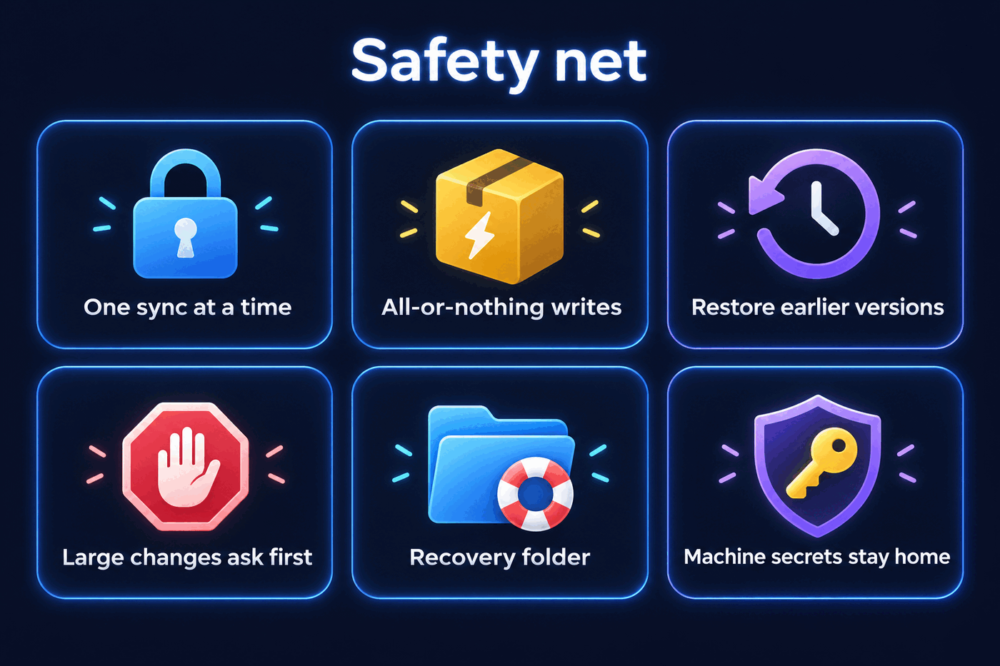

<p align="center">
  
</p>

<p align="center">
  <a href="https://www.npmjs.com/package/opencode-github-sync"></a>
  <a href="https://github.com/lazyalex616/opencode-github-sync/actions/workflows/ci.yml"></a>
  <a href="https://github.com/lazyalex616/opencode-github-sync/blob/main/LICENSE"></a>
  
  
</p>

<p align="center">
  <b>English</b> · <a href="./README.zh-CN.md">简体中文</a>
</p>

<p align="center">
  <a href="#install">Install</a>
  &nbsp;·&nbsp;
  <a href="#first-run">First run</a>
  &nbsp;·&nbsp;
  <a href="#what-gets-synced">What gets synced</a>
  &nbsp;·&nbsp;
  <a href="#opencode-2">OpenCode 2</a>
  &nbsp;·&nbsp;
  <a href="#autosync">Autosync</a>
  &nbsp;·&nbsp;
  <a href="#commands">Commands</a>
  &nbsp;·&nbsp;
  <a href="#troubleshooting">Troubleshooting</a>
</p>

---

You use OpenCode on more than one computer, and every machine drifts: a new
agent here, an MCP server there, a skill you installed on the laptop and forgot
on the desktop.

**opencode-github-sync** keeps all of them on one setup through a private
GitHub repository. Run it by hand when you want, or let your everyday machines
sync themselves in the background. It works with OpenCode 1 and OpenCode 2,
and both can share the same repository.

**What you get**

- Config, instruction files, agents, commands, plugins, themes and skills on
  every machine.
- Optionally your logins and your recent conversations, too.
- Settings that belong to one machine stay on that machine.
- Nothing is overwritten without a copy kept first, and a broken sync can be
  repaired from the command line even when OpenCode will not start.

## Contents

- [Install](#install)
- [First run](#first-run)
- [What gets synced](#what-gets-synced)
- [OpenCode 2](#opencode-2)
- [Autosync](#autosync)
- [Per-machine overrides](#per-machine-overrides)
- [Sessions](#sessions)
- [Credentials](#credentials)
- [Safety](#safety)
- [The menu](#the-menu)
- [OpenCode plugin](#opencode-plugin)
- [Commands](#commands)
- [Settings file](#settings-file)
- [Troubleshooting](#troubleshooting)
- [Upgrading](#upgrading)
- [Development](#development)

---

## Install

**macOS / Linux**

```bash
curl -fsSL https://raw.githubusercontent.com/lazyalex616/opencode-github-sync/main/install.sh | sh
```

**Windows** (PowerShell 5.1 or 7)

```powershell
irm https://raw.githubusercontent.com/lazyalex616/opencode-github-sync/main/install.ps1 | iex
```

The installer checks for Node.js 18+ and git. If one is missing it shows the
command that would install it and asks before running anything. Then it runs
`npm install -g opencode-github-sync@latest` and opens the menu.

Already have Node.js? This does the same:

```bash
npm install -g opencode-github-sync
opencode-sync
```

**Requirements**

| | Needed for |
| --- | --- |
| Node.js 18 or newer | everything |
| Node.js 22.5 or newer | sessions, and credentials on OpenCode 2 (they use Node's built-in SQLite) |
| git | everything |
| GitHub CLI (`gh`), signed in | only `init`, which creates the repository for you |
| OpenCode 1.3.4+ or 2.x | the optional plugin |

### Set up a machine in one line

Pass options to skip every question, for example when preparing a new
machine:

```bash
curl -fsSL https://raw.githubusercontent.com/lazyalex616/opencode-github-sync/main/install.sh | sh -s -- --mode auto --repo you/my-opencode-config
```

```powershell
& ([scriptblock]::Create((irm https://raw.githubusercontent.com/lazyalex616/opencode-github-sync/main/install.ps1))) -Mode auto -Repo you/my-opencode-config
```

| Option | Meaning |
| --- | --- |
| `--mode cli` | Install the command only |
| `--mode link` | Link `--repo` and sync once |
| `--mode auto` | Link, sync once and turn on autosync |
| `--repo owner/name` | The repository (a git URL works too); created as private if it does not exist |
| `--interval N` | Autosync every N minutes (minimum 2, default 5) |
| `--lang en` / `zh-CN` | Interface language |
| `--proxy URL` | Proxy for npm and git, during install and for later syncs |
| `--yes` | Install a missing Node.js or git without asking |
| `--package SPEC` | npm package spec to install (default `opencode-github-sync@latest`) |
| `--dry-run` | Print what would run, change nothing |

On Windows each option is the same word with one leading dash: `-Mode`,
`-Repo`, `-Interval`, `-Lang`, `-Proxy`, `-Yes`, `-Package`, `-DryRun`.

---

## First run

<p align="center">
  
</p>

The first time you run `opencode-sync` it asks how this machine should work:

| | Command only | Primary device + autosync |
| --- | --- | --- |
| How it syncs | You run `opencode-sync push` / `pull`, or the plugin pulls when OpenCode starts | The operating system syncs every few minutes, even while OpenCode is closed |
| Good for | A machine you use now and then, a shared or locked-down machine | The machines you work on every day |
| Background job | None | Task Scheduler, launchd or a systemd timer |

Then it links a repository:

- **No repository yet?** It creates a private one with `gh` (or run
  `opencode-sync init`).
- **Already have one?** Pick it from the list, or give `owner/name` or any git
  URL (or run `opencode-sync link owner/name`).

If the repository already has content and this machine has its own files, the
menu shows the differences and lets you pick a side. The losing side's files
are copied to the [recovery folder](#safety) first.

You can change your mind any time under **Autosync**. Autosync is per machine:
turning it on here never turns it on anywhere else.

---

## What gets synced

<p align="center">
  
</p>

Your `~/.config/opencode` folder becomes a working copy of the repository.
Everything that lives elsewhere is mirrored into a folder inside it.

| On your machine | In the repository | What it holds |
| --- | --- | --- |
| `~/.config/opencode/` | the root | `opencode.json(c)`, `tui.json(c)`, OpenCode 2's `cli.json`, agents, commands, plugins, themes, instruction files |
| `~/.local/share/opencode/` | `_data/` | project metadata; logins if you [opt in](#credentials) |
| `~/.local/state/opencode/` | `_state/` | model cache and other interface state |
| `~/.agents/skills/` | `_agents/` | skills installed with the `skills` CLI |
| selected sessions | `_sessions/` | one small compressed file per session, if you [opt in](#sessions) |
| your extra paths | `_extra/` | any other file or folder you add, such as `.config/gh/config.yml` |

Each part can be switched off under **What to sync**. A part you switch off
stays local in both directions: your edits are not sent, and other machines'
versions do not replace yours.

**Never synced**

- The `opencode.db` database itself, tool output, snapshots and logs. Sessions
  travel as separate small files instead.
- `node_modules` and other generated folders.
- opencode-sync's own settings and overrides files.
- Anything that describes one machine rather than your setup: OpenCode 2's
  `service.json` (one in the config folder and one in the state folder; each
  holds the local background service's password), lock files, prompt history,
  recent-file lists, and `cli.json` plugin entries that point into this
  machine's home folder.

---

## OpenCode 2

opencode-github-sync 3.3.0 and later support OpenCode 2 (`@opencode/cli`) fully.
Machines on OpenCode 1 and OpenCode 2 can use one repository side by side.

What is different on OpenCode 2, and what this tool does about it:

| OpenCode 2 changed | What opencode-sync does |
| --- | --- |
| Sessions live in new tables, and a fresh OpenCode 2 database has no old ones | Reads and writes OpenCode 2's own tables. OpenCode 1 machines keep their own format; each side imports only its own kind and leaves the other's in place |
| `/session` lists only the sessions of the current folder's project | Each imported session is placed in the project OpenCode 2 uses for that folder on the receiving machine, so it appears in `/session` |
| Sessions migrated from 1.x can vanish from `/session` | `opencode-sync repair-sessions` moves them back where `/session` looks |
| Logins live in the database, and `auth.json` is read at most once | With credential sync on, logins are copied between the two around every sync |
| Interface preferences moved to `cli.json` | Shared as part of the main config, without this machine's plugin paths |
| A `service.json` with a password sits in the config folder | Never committed, and removed from repositories an older version wrote it into |
| Configuration reloads by itself | The "restart OpenCode" hint only appears where a restart is still needed: OpenCode 1, or a changed plugin |

To move a machine from OpenCode 1 to 2, see [Upgrading to OpenCode 2](#upgrading-to-opencode-2).

---

## Autosync

<p align="center">
  
</p>

When autosync is on, the operating system starts `opencode-sync autosync run`
every few minutes and at sign-in (on Windows also when you unlock the screen or
reconnect over Remote Desktop). Each run makes one decision:

1. **Is it quiet?** If a file in your config or skills folders changed in the
   last minute, something is still being written. Sending now could publish a
   half-saved file, so the push waits.
2. **Can it at least receive?** While you are busy it still takes other
   machines' changes, but only when this machine has nothing of its own
   waiting. Otherwise everything waits for the next run.
3. **Push and receive.** Your changes go up and other machines' changes come
   down in one step.

The rules that keep it safe:

- **Machines take turns.** Each machine waits a few seconds, fixed per machine,
  so two machines on the same schedule do not collide every time. If another
  machine still gets there first, this one takes the new commit and tries
  again; that does not count as an error.
- **It backs off but never gives up.** After three failures in a row (usually
  no network) it waits 30 minutes, then an hour between attempts. The first
  success puts it back on schedule.
- **It interrupts you twice at most.** One notification when it starts backing
  off, one when it recovers. Ordinary syncs are silent.
- **It never runs twice at once.** One lock is shared by the scheduled job, the
  command, the menu and every OpenCode window; whoever finds it busy skips.
- **It never approves a large change by itself.** Anything that trips the
  [large-change guard](#safety) is held back and you get a notification.
- **It renews a shared ChatGPT login.** See [Credentials](#credentials).

| Platform | Scheduler | Notes |
| --- | --- | --- |
| Windows | Task Scheduler | Runs hidden. To run while signed out, turn it on in the menu and install from an administrator terminal |
| macOS | launchd agent | `~/Library/LaunchAgents/com.opencode-github-sync.autosync.plist` |
| Linux | systemd user timer | Falls back to a crontab line. On a server, run `loginctl enable-linger` so it runs while you are logged out |

`opencode-sync autosync status` shows the last run, the last error and the next
attempt. With autosync on, the plugin stops pushing on idle so the two never
compete; it still pulls when OpenCode starts.

---

## Per-machine overrides

Some settings belong to one machine only: a work proxy, a local tool path, an
MCP server that only exists on one box. Put them in
`~/.config/opencode/opencode-sync.overrides.jsonc`, or use **This machine's
overrides** in the menu:

```jsonc
{
  "model": "github-copilot/claude-sonnet-4",
  "mcp": {
    "playwright": { "enabled": true }
  }
}
```

```
   repo opencode.jsonc        shared, committed
 + overrides.jsonc            this machine only, never committed
 ─────────────────────────    merged
 = effective opencode.jsonc   what OpenCode reads
```

Objects merge key by key, lists and plain values replace, and `null` removes a
key. Before every push, each key the overrides file claims is put back to the
repository's value, so your machine-only values never reach other machines.
Without an overrides file the config is copied exactly as written, comments
and all.

---

## Sessions

Off by default. Turn it on only for a private repository: conversations are
private.

```bash
opencode-sync sessions enable
opencode-sync sessions list
opencode-sync sessions include ses_065cad1caffeN3lf1RgLZno30   # always sync this one
opencode-sync sessions exclude ses_0ba19b4e7ffeMbSmWYi3Nj6xfZ  # never sync this one
```

Sessions are not synced by committing the database. A real OpenCode database
grows to several gigabytes, mostly tool output, and git cannot merge it.
Instead each session is exported on its own as a small compressed file:

- **Small.** Only recent sessions travel (7 days and 50 sessions by default),
  and any single session over 5 MB is skipped.
- **Conflicts are rare and resolved.** Two machines working on different
  sessions touch different files. When one session changed on two machines, the
  newer copy wins; on OpenCode 2 the replaced local copy is saved to the
  recovery folder first if it had messages the newer one lacks.
- **Never disturbs a running conversation.** A session that is busy on this
  machine is not replaced, and runtime state (busy, compacting, retry counters)
  is never carried over, so a receiving machine never resumes a conversation on
  its own.
- **Lands in the right place.** On OpenCode 2 an imported session is placed in
  the project OpenCode 2 uses for its folder here. A folder under the other
  machine's home is matched to the same folder under yours; a folder this
  machine does not have puts the session in your home folder's project.
- **Safe to import.** Each session is imported in one transaction, so a failure
  leaves your database as it was.

Window, count and size limits are under **What to sync → Session settings**.
Sessions need Node.js 22.5 or newer.

**Sessions missing from `/session` after upgrading to OpenCode 2?** OpenCode's
own migration leaves some of them in a project `/session` never shows. Their
content is intact:

```bash
opencode-sync repair-sessions          # preview: what would move where
opencode-sync repair-sessions --apply  # move them
```

---

## Credentials

Off by default, and refused outright when the repository is public. Turn it on
under **What to sync → Credentials** or with `"includeCredentials": true`.

On OpenCode 1, `auth.json` is synced as a file. On OpenCode 2, which keeps
logins in its database, opencode-sync also copies between the database and
`auth.json` around every sync:

- The account you pick in OpenCode (for example after `/connect` or switching
  accounts) is what the other machines receive. A running OpenCode picks up an
  incoming account on its next request, without a restart.
- A renewed login updates the existing account instead of adding a copy. When
  both sides changed, the one that expires later wins.
- An account missing from an incoming copy never logs this machine out.
  Logging out on a machine removes that account from the shared copy.
- A broken or half-written `auth.json` is never overwritten.
- To tell which side changed, only hashes of the last synced values are kept,
  in `opencode-sync-credentials.json` next to the database. Never the secrets.

**Shared ChatGPT login.** Renewing an OpenAI login invalidates the previous
one, so machines that each renew the same login log each other out. With
credential sync on, only one machine renews it: the scheduled job claims a
lease in the sync repository (an atomic operation on GitHub's side), renews
three days before the login expires, and the next sync hands the new login to
every other machine. A claim older than 15 minutes is considered abandoned and
can be taken over. Set `"openaiRefreshLease": false` to turn this off.

---

## Safety

<p align="center">
  
</p>

- **All-or-nothing writes.** Files are written beside their target and then
  swapped in, so a crash mid-sync cannot leave a half-written config that stops
  OpenCode from starting.
- **Push verification.** After pushing, the remote is read back. `git push`
  can report success without the remote changing; that is checked, not
  assumed.
- **One sync at a time.** A lock shared by the plugin, the command, the menu
  and the scheduled job.
- **Large-change guard.** A push that adds more than 300 files, more than
  10 MB in total, or any single file over 2 MB stops and asks. The limits are
  adjustable. Generated folders such as `node_modules`, `.venv`, `venv`,
  `__pycache__`, `dist` and `.cache` are never sent.
- **Recovery folder.** Before a forced pull, a "repository wins" first link, a
  restore from history, or replacing a session that was continued on both
  machines, what is about to be replaced is copied to
  `~/.local/share/opencode/opencode-sync-recovery/<time>-<reason>/`.
- **Machine secrets stay home.** OpenCode 2's `service.json`, lock files and
  per-machine histories are never committed.
- **Your hostname stays private.** Commits name the machine by a stable
  pseudonym (or a name you choose), never by its real hostname.
- **Symlinks are refused, not followed**, so a sync cannot copy files from
  outside the folders it owns.

---

## The menu

Run `opencode-sync` with no arguments.

<p align="center">
  
</p>

Arrow keys or the shown hotkey pick an item, space ticks a checkbox, Enter
confirms and Esc goes back. When the input is not a terminal (a pipe, a script,
CI) every prompt becomes a numbered question, so the menu can be driven from a
file.

| Item | What you can do there |
| --- | --- |
| **Sync now** | Push and receive, receive only, push only, or preview first |
| **What to sync** | Tick main config, instruction files, agents, commands, plugins, skills, credentials, sessions; set session limits; add extra paths |
| **Autosync** | On or off; every 5/10/15/30/60 minutes or your own interval; pause; run while signed out (Windows); notifications |
| **Update** | Check npm for a newer version, upgrade, or update automatically once a day |
| **This machine's overrides** | Open the overrides file in your editor and see what it changes |
| **Diagnostics** | git, node, gh, repository access, the scheduled job, the last log lines; export a support bundle |
| **Danger zone** | Make this machine match the repository, or the other way round (type `overwrite` to confirm) |
| **Uninstall** | Remove the scheduled job, optionally unlink and remove the command. Your configuration is never deleted |
| **Network proxy** | A proxy for git, gh and npm, used only by opencode-sync |
| **Restore a file from history** | Pick a file, pick a version, put it back |
| **Devices** | Every machine that has synced and when; rename this one |
| **Large-change guard** | The limits that make a big push stop and ask |
| **Language** | English, 简体中文 or automatic |

---

## OpenCode plugin

The plugin is optional. It pulls when OpenCode starts, can push when a session
goes idle, and adds an `opencode_sync` tool so you can ask for a sync in plain
language.

```jsonc
// ~/.config/opencode/opencode.json
{
  "$schema": "https://opencode.ai/config.json",
  "plugin": ["opencode-github-sync"]
}
```

The `"plugin"` key works on OpenCode 1.x (1.3.4 and later) and 2.x. If you run
only OpenCode 2 you can use its native `"plugins"` key instead, but do not list
the plugin under both: OpenCode 2 loads entries from both lists. OpenCode
1.0–1.3.3 cannot load 3.1.0 and later; stay on `opencode-github-sync@3.0.1`
there.

Keep the command installed even if you use the plugin. A plugin cannot repair
a configuration that stops OpenCode from loading it; `opencode-sync pull
--force` can.

---

## Commands

| Command | What it does |
| --- | --- |
| `opencode-sync` | Open the menu (same as `opencode-sync menu`) |
| `opencode-sync init [name]` | Create a private sync repository with `gh` |
| `opencode-sync link <owner/repo or URL>` | Use an existing repository |
| `opencode-sync setup --mode cli\|link\|auto` | Non-interactive setup, used by the installers |
| `opencode-sync push` | Send this machine's changes |
| `opencode-sync pull` | Take the shared configuration |
| `opencode-sync status` | What is in sync and what is not |
| `opencode-sync autosync enable` / `disable` | Turn autosync on or off for this machine |
| `opencode-sync autosync install` / `uninstall` | Register or remove the scheduled job only |
| `opencode-sync autosync status` | Last run, last error, next attempt |
| `opencode-sync autosync run` | One scheduled pass, now |
| `opencode-sync autosync pause <hours>\|tomorrow` / `resume` | Pause or resume |
| `opencode-sync autosync reset` | Clear the failure counter |
| `opencode-sync sessions list\|enable\|disable` | Session sync |
| `opencode-sync sessions include\|exclude <id>` | Always or never sync one session |
| `opencode-sync repair-sessions [--apply]` | OpenCode 2: move sessions missing from `/session` into their project (preview without `--apply`) |
| `opencode-sync overrides` | Create or locate the overrides file |
| `opencode-sync config` | Print the settings |

| Flag | Effect |
| --- | --- |
| `--force` | Overwrite the other side (asks you to type `yes`; `--yes` skips) |
| `--dry-run` | Show what would change, change nothing |
| `--allow-large` | Push even when the large-change guard objects |
| `--lang en\|zh-CN` | Interface language for this run |

| Environment variable | Effect |
| --- | --- |
| `OPENCODE_SYNC_LANG` | Interface language |
| `OPENCODE_SYNC_HOST_ALIAS` | Machine name used in commits |
| `OPENCODE_SYNC_PROXY` | Proxy for git, gh and npm |
| `OPENCODE_SYNC_VERBOSE=1` | Full file lists and stack traces |
| `SYNC_REMOTE_URL` | Override the repository URL |
| `NO_COLOR` | Plain output |

---

## Settings file

`~/.config/opencode/opencode-sync.jsonc` stays on this machine and is never
committed. The menu edits it for you; every key is optional.

```jsonc
{
  "repo": { "owner": "you", "name": "my-opencode-config", "branch": "main" },
  "machineAlias": "laptop",
  "includeCredentials": false,
  "openaiRefreshLease": true,
  "includeSkills": true,
  "includeState": true,
  "extraPaths": [".config/gh/config.yml"],
  "categories": { "config": true, "instructions": true, "agents": true, "commands": true, "plugins": true },
  "sessions": { "enabled": false, "days": 7, "maxSessions": 50, "maxSessionBytes": 5242880 },
  "autosync": { "enabled": false, "intervalMinutes": 5, "settleSeconds": 60, "runWhenLoggedOff": false, "autoUpdate": false },
  "guard": { "maxFiles": 300, "maxBytes": 10485760, "maxFileBytes": 2097152 },
  "proxy": "",
  "language": "",
  "notifications": true,
  "autoPullOnStartup": true,
  "autoPushOnIdle": false
}
```

| Key | Meaning |
| --- | --- |
| `machineAlias` | Name for this machine in commits; unset means a stable pseudonym |
| `includeCredentials` | Sync logins ([Credentials](#credentials)); private repositories only |
| `openaiRefreshLease` | With credentials on, let one machine at a time renew a shared ChatGPT login |
| `includeSkills` / `includeState` | Sync `~/.agents/skills` / `~/.local/state/opencode` |
| `extraPaths` | Extra files or folders, relative to your home folder |
| `categories` | Which parts of the config folder are shared |
| `sessions` | [Session](#sessions) window, count and size limits |
| `autosync` | [Autosync](#autosync) interval, quiet period, run while signed out, daily self-update |
| `guard` | [Large-change guard](#safety) limits |
| `autoPullOnStartup` / `autoPushOnIdle` | What the [plugin](#opencode-plugin) does |

---

## Troubleshooting

**I am behind a proxy.** Pass `--proxy http://host:port` (or `-Proxy` on
Windows) to the installer. It is used for npm and git during the install and
saved for later syncs, including the ChatGPT login renewal. Change it any time
under **Network proxy**.

**`curl | sh` does not ask me anything.** The script itself arrives through the
pipe, so it reads your answers from the terminal instead. Where there is no
terminal (CI, a Dockerfile) nobody can answer: pass `--mode` and `--repo`, plus
`--yes` if Node.js or git may need installing.

**Windows says running scripts is disabled.** `irm ... | iex` does not run a
script file, so the execution policy does not apply. To run a downloaded
`install.ps1` as a file, use `powershell -ExecutionPolicy Bypass -File install.ps1`.

**`opencode-sync` is not found after installing.** npm installed it into a
folder that is not on your `PATH`. `npm prefix -g` shows the folder; add its
`bin` (or the folder itself on Windows) to `PATH`.

**Autosync is on but nothing happens.** Run `opencode-sync autosync status`. It
shows whether it is paused, backing off after errors, or waiting because files
are still changing. **Diagnostics** in the menu shows whether the scheduled job
is registered.

**A synced session does not show up in `/session` (OpenCode 2).** Open
OpenCode in the session's folder; `/session` lists only that folder's project.
Sessions from before your upgrade to OpenCode 2: run
`opencode-sync repair-sessions --apply`.

**Sessions are not synced at all.** Check `opencode-sync status` shows session
sync as on, and that `node --version` is 22.5 or newer.

**A login did not arrive on another machine (OpenCode 2).** Credentials must be
on for both machines. Run a sync on the machine where you logged in, then on
the other one. If two accounts of one provider are both marked active, nothing
is changed for that provider; switch accounts once in OpenCode to settle it.

**A pull conflicted with my local edits.** Your edits are kept in a git stash
and the exact commands to get them back are printed. Nothing is lost.

**"This machine has N commits that were never pushed."** Pulling would throw
them away, so it stops. Run `opencode-sync push`, or `pull --force` to discard
them.

**Authentication failed.** Run `gh auth login -h github.com`. Private
repositories need the `repo` scope.

**OpenCode will not start after a sync.** This is what the command is for:

```bash
opencode-sync pull --force
```

The files it replaces go to the recovery folder first.

---

## Upgrading

### Upgrading to OpenCode 2

Upgrade opencode-github-sync to 3.3.0 or later on every machine first. 3.2.x
cannot read OpenCode 2 sessions, and it commits OpenCode 2's `service.json`.

1. Install OpenCode 2. With npm 12 its install scripts must be allowed, or the
   `opencode` command is only a placeholder:

   ```bash
   npm install -g @opencode/cli --allow-scripts=@opencode/cli
   ```

2. Optionally stop OpenCode 2 from updating itself in the background; an
   unattended self-update through npm 12 can break the install:

   ```bash
   opencode service set env OPENCODE_DISABLE_AUTOUPDATE 1
   ```

3. Start OpenCode 2 once so it migrates your 1.x data, then bring back the
   sessions `/session` no longer shows:

   ```bash
   opencode-sync repair-sessions          # preview
   opencode-sync repair-sessions --apply
   ```

**If you synced with 3.2.x on OpenCode 2**, your repository may contain
`service.json` and `_state/service.json`. 3.3.0 removes them on its next push,
but they stay in the repository's history. The password in them only opens the
local background service of that machine. To remove them from history as well,
delete the repository and push again from one machine.

### Upgrading from 3.1.x or 3.2.x

```bash
npm install -g opencode-github-sync@latest
```

Nothing else is required: settings, overrides and the repository keep working,
and autosync stays off until you turn it on. If you sync on a timer with a
script of your own, remove it before turning autosync on so the two do not
compete. If you used `autoPushOnIdle` in the plugin, autosync replaces it on
machines where you turn it on. The [changelog](./CHANGELOG.md) lists every
change.

---

## Development

```bash
npm install
npm run check     # lint, typecheck and tests
npm run build
```

The tests run against real git repositories on disk and simulate several
machines, so pushing, pulling, rebasing, autosync scheduling and the menu are
exercised end to end. Session and credential tests use the schema of a real
OpenCode 2.2.5 database and fake tokens only. Real scheduled jobs are only ever
registered on disposable CI runners.

---

## Star history

<a href="https://star-history.com/#lazyalex616/opencode-github-sync&Date">
  <picture>
    <source media="(prefers-color-scheme: dark)" srcset="https://api.star-history.com/svg?repos=lazyalex616/opencode-github-sync&type=Date&theme=dark">
    <source media="(prefers-color-scheme: light)" srcset="https://api.star-history.com/svg?repos=lazyalex616/opencode-github-sync&type=Date">
    
  </picture>
</a>

---

## License

[MIT](https://github.com/lazyalex616/opencode-github-sync/blob/main/LICENSE)

<p align="center">
  <sub>If this saved you some time, a ⭐ is appreciated.</sub>
</p>
