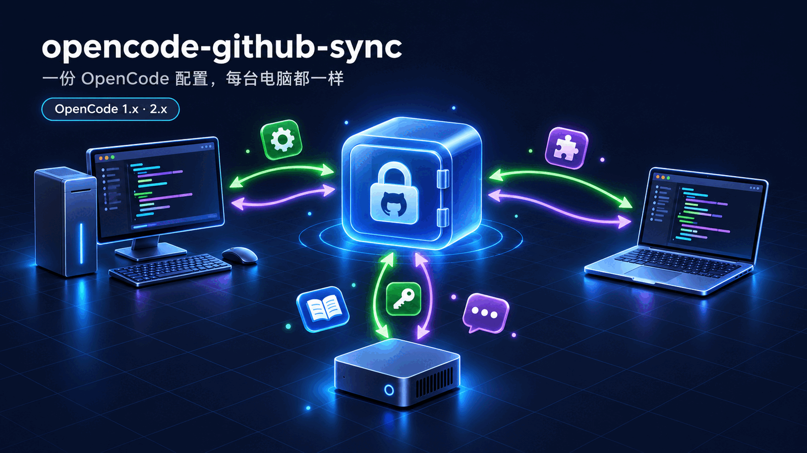
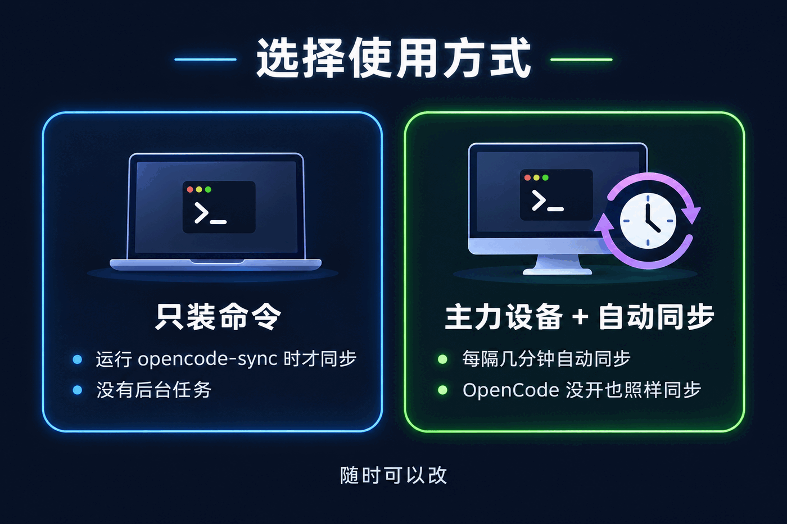
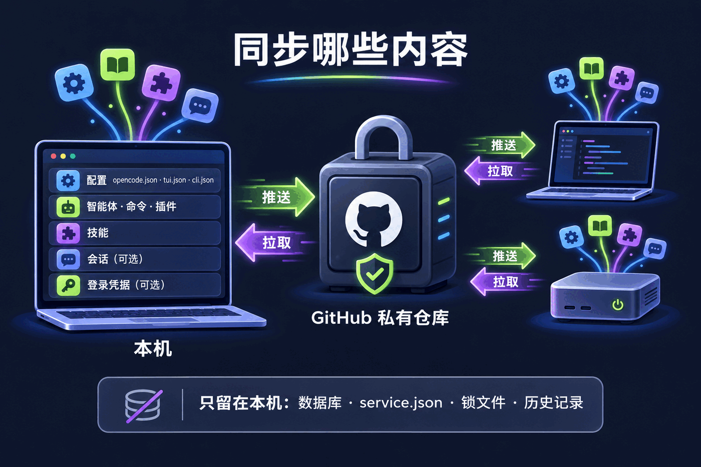
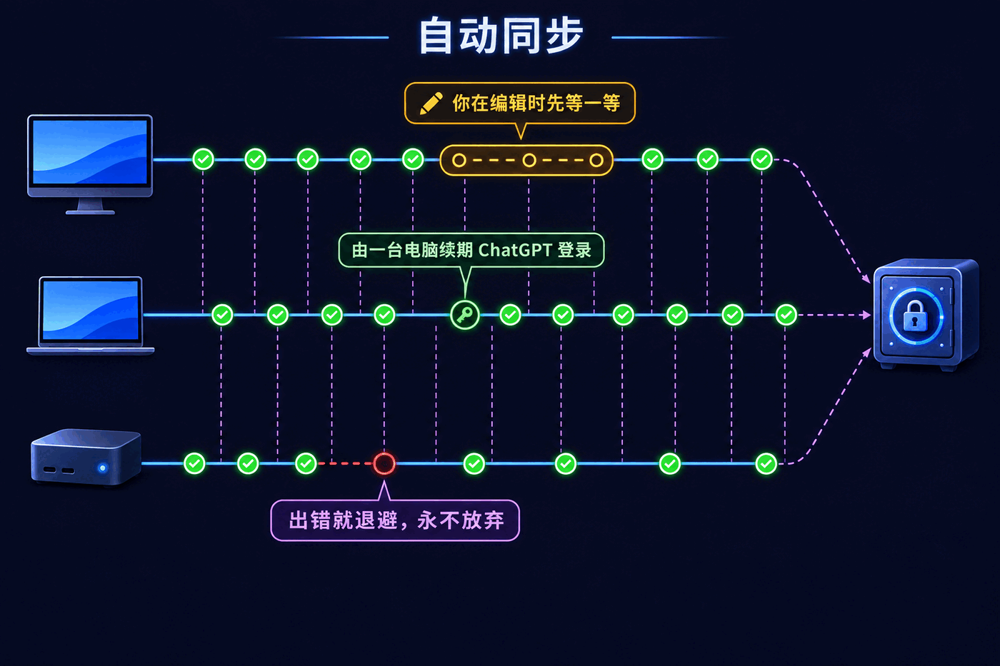
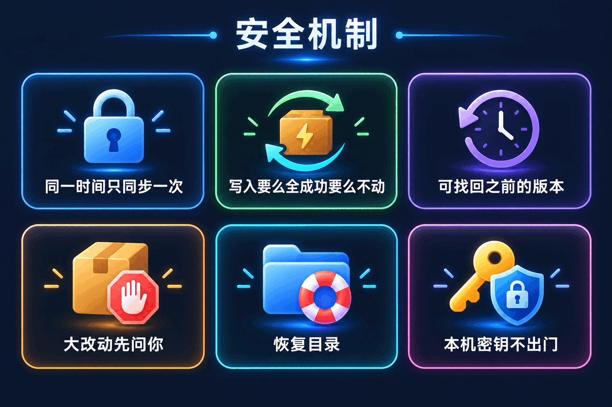

<p align="center">
  
</p>

<p align="center">
  <a href="https://www.npmjs.com/package/opencode-github-sync"></a>
  <a href="https://github.com/lazyalex616/opencode-github-sync/actions/workflows/ci.yml"></a>
  <a href="https://github.com/lazyalex616/opencode-github-sync/blob/main/LICENSE"></a>
  
  
</p>

<p align="center">
  <a href="./README.md">English</a> · <b>简体中文</b>
</p>

<p align="center">
  <a href="#安装">安装</a>
  &nbsp;·&nbsp;
  <a href="#第一次运行">第一次运行</a>
  &nbsp;·&nbsp;
  <a href="#同步哪些内容">同步哪些内容</a>
  &nbsp;·&nbsp;
  <a href="#opencode-2">OpenCode 2</a>
  &nbsp;·&nbsp;
  <a href="#自动同步">自动同步</a>
  &nbsp;·&nbsp;
  <a href="#命令速查">命令</a>
  &nbsp;·&nbsp;
  <a href="#常见问题">常见问题</a>
</p>

---

你在好几台电脑上用 OpenCode，每台都会慢慢变得不一样：这台加了个智能体，那台多了个 MCP 服务器，笔记本上装的技能台式机上又忘了装。

**opencode-github-sync** 借助一个 GitHub 私有仓库，让所有电脑保持同一套配置。想手动同步就手动，也可以让每天用的电脑在后台自己同步。OpenCode 1 和 OpenCode 2 都支持，两种版本的电脑还能共用同一个仓库。

**能得到什么**

- 配置、指令文件、智能体、自定义命令、插件、主题和技能，每台电脑都一样。
- 可选：登录凭据和最近的对话也一起同步。
- 只属于某台电脑的设置，留在那台电脑上。
- 覆盖任何东西之前都会先留一份副本；同步出了问题导致 OpenCode 启动不了，也能用命令行修好。

## 目录

- [安装](#安装)
- [第一次运行](#第一次运行)
- [同步哪些内容](#同步哪些内容)
- [OpenCode 2](#opencode-2)
- [自动同步](#自动同步)
- [本机专属设置](#本机专属设置)
- [会话同步](#会话同步)
- [登录凭据](#登录凭据)
- [安全机制](#安全机制)
- [菜单一览](#菜单一览)
- [OpenCode 插件](#opencode-插件)
- [命令速查](#命令速查)
- [设置文件](#设置文件)
- [常见问题](#常见问题)
- [升级](#升级)
- [开发](#开发)

---

## 安装

**macOS / Linux**

```bash
curl -fsSL https://raw.githubusercontent.com/lazyalex616/opencode-github-sync/main/install.sh | sh
```

**Windows**（PowerShell 5.1 或 7 都可以）

```powershell
irm https://raw.githubusercontent.com/lazyalex616/opencode-github-sync/main/install.ps1 | iex
```

安装脚本会先检查 Node.js 18+ 和 git。缺了哪个，就把安装命令列出来，问过你才执行。之后运行 `npm install -g opencode-github-sync@latest`，并打开菜单。

已经装了 Node.js？下面两行效果一样：

```bash
npm install -g opencode-github-sync
opencode-sync
```

**环境要求**

| | 用途 |
| --- | --- |
| Node.js 18 或更新 | 所有功能 |
| Node.js 22.5 或更新 | 会话同步，以及 OpenCode 2 上的登录凭据同步（用到 Node 自带的 SQLite） |
| git | 所有功能 |
| 已登录的 GitHub CLI（`gh`） | 只有 `init` 需要，用来帮你新建仓库 |
| OpenCode 1.3.4+ 或 2.x | 可选的插件 |

### 一行命令配好一台电脑

带上参数就能跳过所有提问，适合给新电脑部署：

```bash
curl -fsSL https://raw.githubusercontent.com/lazyalex616/opencode-github-sync/main/install.sh | sh -s -- --mode auto --repo 你的用户名/my-opencode-config
```

```powershell
& ([scriptblock]::Create((irm https://raw.githubusercontent.com/lazyalex616/opencode-github-sync/main/install.ps1))) -Mode auto -Repo 你的用户名/my-opencode-config
```

| 参数 | 作用 |
| --- | --- |
| `--mode cli` | 只装命令 |
| `--mode link` | 关联 `--repo` 并同步一次 |
| `--mode auto` | 关联、同步一次，并开启自动同步 |
| `--repo 用户名/仓库名` | 要用的仓库（也可以是 git 地址）；不存在时会新建为私有仓库 |
| `--interval N` | 每 N 分钟自动同步一次（最少 2，默认 5） |
| `--lang en` / `zh-CN` | 界面语言 |
| `--proxy 地址` | npm 和 git 用的代理，安装时和之后同步时都会用 |
| `--yes` | 缺 Node.js 或 git 时不再询问，直接安装 |
| `--package 包名` | 要安装的 npm 包（默认 `opencode-github-sync@latest`） |
| `--dry-run` | 只打印要执行的步骤，什么都不改 |

Windows 上参数名相同，前面换成一个短横线：`-Mode`、`-Repo`、`-Interval`、`-Lang`、`-Proxy`、`-Yes`、`-Package`、`-DryRun`。

---

## 第一次运行

<p align="center">
  
</p>

第一次运行 `opencode-sync` 时，它会问你这台电脑打算怎么用：

| | 只装命令 | 主力设备 + 自动同步 |
| --- | --- | --- |
| 怎么同步 | 你自己运行 `opencode-sync push` / `pull`，或者插件在 OpenCode 启动时拉取 | 操作系统每隔几分钟同步一次，OpenCode 没开也照样同步 |
| 适合 | 偶尔用一下的电脑、共用或受管控的电脑 | 每天干活用的电脑 |
| 后台任务 | 无 | 任务计划程序、launchd 或 systemd 定时器 |

然后关联一个仓库：

- **还没有仓库？** 它会用 `gh` 帮你建一个私有仓库（也可以运行 `opencode-sync init`）。
- **已经有了？** 从列表里选，或者填 `用户名/仓库名`、任意 git 地址（也可以运行 `opencode-sync link 用户名/仓库名`）。

如果仓库里已经有内容、本机也有自己的文件，菜单会先列出差异让你选以哪边为准。被替换那一边的文件会先复制到[恢复目录](#安全机制)。

之后随时可以在**自动同步**菜单里改。自动同步按电脑单独开启：在这台打开，不会影响其他任何一台。

---

## 同步哪些内容

<p align="center">
  
</p>

`~/.config/opencode` 文件夹本身就是仓库的工作目录，其他位置的内容会镜像到仓库里的子文件夹。

| 本机位置 | 仓库里的位置 | 内容 |
| --- | --- | --- |
| `~/.config/opencode/` | 根目录 | `opencode.json(c)`、`tui.json(c)`、OpenCode 2 的 `cli.json`、智能体、自定义命令、插件、主题、指令文件 |
| `~/.local/share/opencode/` | `_data/` | 项目信息；[开启后](#登录凭据)还有登录凭据 |
| `~/.local/state/opencode/` | `_state/` | 模型缓存等界面状态 |
| `~/.agents/skills/` | `_agents/` | 用 `skills` 命令安装的技能 |
| 选中的会话 | `_sessions/` | 每个会话一个压缩小文件，需要[开启](#会话同步) |
| 额外路径 | `_extra/` | 你自己加的任意文件或文件夹，比如 `.config/gh/config.yml` |

每一项都能在**同步哪些内容**里关掉。关掉的项双向都只留在本机：你的改动不会推上去，别的电脑的版本也不会覆盖你的。

**永远不同步**

- `opencode.db` 数据库本身、工具输出、快照和日志。会话改为单独导出成小文件同步。
- `node_modules` 之类的生成目录。
- opencode-sync 自己的设置文件和专属设置文件。
- 只描述某一台电脑、而不是你的配置的东西：OpenCode 2 的 `service.json`（配置目录和状态目录里各一份，里面都有本机后台服务的密码）、锁文件、输入历史、最近文件列表，以及 `cli.json` 里指向本机用户目录的插件条目。

---

## OpenCode 2

opencode-github-sync 3.3.0 起完整支持 OpenCode 2（`@opencode/cli`）。OpenCode 1 和 OpenCode 2 的电脑可以同时用一个仓库。

OpenCode 2 改了什么，这个工具怎么应对：

| OpenCode 2 的变化 | opencode-sync 的做法 |
| --- | --- |
| 会话存在新的表里，全新的 OpenCode 2 数据库根本没有旧表 | 直接读写 OpenCode 2 自己的表。OpenCode 1 的电脑保留原来的格式；各自只导入自己那一类，不会删掉对方的 |
| `/session` 只列出当前文件夹所属项目的会话 | 导入的会话会放进接收方 OpenCode 2 为那个文件夹使用的项目里，所以能在 `/session` 里看到 |
| 从 1.x 迁移过来的会话可能在 `/session` 里消失 | `opencode-sync repair-sessions` 把它们移回 `/session` 会看的地方 |
| 登录凭据存在数据库里，`auth.json` 最多只读一次 | 开启凭据同步后，每次同步前后都会在两者之间复制 |
| 界面偏好搬到了 `cli.json` | 归入主配置一起同步，但去掉本机的插件路径 |
| 配置目录里多了一个带密码的 `service.json` | 永远不提交；旧版本提交过的，会从仓库里删掉 |
| 配置会自动重新加载 | 只在真正需要时提示重启：OpenCode 1，或者插件有变化 |

把一台电脑从 OpenCode 1 升到 2，请看[升级到 OpenCode 2](#升级到-opencode-2)。

---

## 自动同步

<p align="center">
  
</p>

开启自动同步后，操作系统每隔几分钟、以及每次登录时（Windows 上还包括解锁屏幕和远程桌面重连时）运行一次 `opencode-sync autosync run`。每次运行只做一个判断：

1. **现在安静吗？** 如果配置或技能文件夹里最近一分钟有文件变化，说明还在写入。这时推送可能把写了一半的文件发出去，所以先不推。
2. **至少能接收吗？** 你在忙的时候它照样接收别的电脑的改动，但前提是本机没有自己的改动在等着。否则全部留到下一次。
3. **推送并接收。** 你的改动上传、别的电脑的改动下载，一步完成。

保证安全的规则：

- **电脑之间错开时间。** 每台电脑等几秒钟（每台固定），同一时间表的两台不会每次都撞上。别的电脑还是抢先了，这台就接过新提交再试一次，不算出错。
- **会退避，但永不放弃。** 连续失败三次（通常是没网）后等 30 分钟，之后每小时试一次。第一次成功就恢复正常节奏。
- **最多打扰你两次。** 开始退避时通知一次，恢复时通知一次。平常同步不弹任何东西。
- **同一时间只跑一个。** 定时任务、命令行、菜单和每个 OpenCode 窗口共用一把锁，谁发现被占用就跳过。
- **从不自己批准大改动。** 触发[大改动保护](#安全机制)的推送会被拦下，并给你发通知。
- **负责续期共用的 ChatGPT 登录。** 见[登录凭据](#登录凭据)。

| 平台 | 调度方式 | 说明 |
| --- | --- | --- |
| Windows | 任务计划程序 | 隐藏运行。想在注销后也运行，先在菜单里打开，再用管理员终端安装 |
| macOS | launchd 代理 | `~/Library/LaunchAgents/com.opencode-github-sync.autosync.plist` |
| Linux | systemd 用户定时器 | 不可用时退回 crontab。服务器上请运行 `loginctl enable-linger`，退出登录后也能运行 |

`opencode-sync autosync status` 会显示上次运行、最后的错误和下次尝试时间。开启自动同步后，插件不再在会话空闲时推送，避免两边抢；OpenCode 启动时照样拉取。

---

## 本机专属设置

有些设置只属于某一台电脑：公司代理、本地工具路径、只在某台电脑上有的 MCP 服务器。把它们写进 `~/.config/opencode/opencode-sync.overrides.jsonc`，或者用菜单里的**本机专属设置**：

```jsonc
{
  "model": "github-copilot/claude-sonnet-4",
  "mcp": {
    "playwright": { "enabled": true }
  }
}
```

```
   仓库里的 opencode.jsonc     共享，会提交
 + overrides.jsonc             只在本机，永不提交
 ─────────────────────────     合并
 = 实际生效的 opencode.jsonc   OpenCode 读的就是它
```

对象按键逐个合并，列表和普通值直接替换，`null` 表示删除这个键。每次推送前，专属设置里出现过的键都会恢复成仓库里的值，所以只属于本机的值永远不会传到别的电脑。没有专属设置文件时，配置原样复制，注释也保留。

---

## 会话同步

默认关闭。只在私有仓库里开启：对话内容是隐私。

```bash
opencode-sync sessions enable
opencode-sync sessions list
opencode-sync sessions include ses_065cad1caffeN3lf1RgLZno30   # 这个会话始终同步
opencode-sync sessions exclude ses_0ba19b4e7ffeMbSmWYi3Nj6xfZ  # 这个会话永不同步
```

会话不是靠提交整个数据库来同步的。真实的 OpenCode 数据库会涨到好几 GB，大部分是工具输出，git 也没法合并它。所以每个会话单独导出成一个压缩小文件：

- **体积小。** 只同步最近的会话（默认 7 天、最多 50 个），单个超过 5 MB 的会话直接跳过。
- **冲突少，而且有处理。** 两台电脑各自处理不同的会话，改的是不同的文件。同一个会话在两台电脑上都有改动时，保留较新的那份；在 OpenCode 2 上，如果本机那份有较新那份没有的消息，会先存进恢复目录再替换。
- **不打扰正在进行的对话。** 本机正在运行的会话不会被替换；运行中的状态（忙碌、压缩中、重试次数）也不会被带过去，所以接收方绝不会自己接着跑一段对话。
- **放到对的地方。** 在 OpenCode 2 上，导入的会话会放进本机 OpenCode 2 为那个文件夹使用的项目里。另一台电脑用户目录下的文件夹，对应到你用户目录下的同名文件夹；本机没有的文件夹，会话放进用户目录的项目里。
- **导入安全。** 每个会话在一个事务里导入，失败了数据库保持原样。

时间范围、数量和大小上限在**同步哪些内容 → 会话同步设置**里调。会话同步需要 Node.js 22.5 或更新版本。

**升级到 OpenCode 2 后，`/session` 里少了会话？** OpenCode 自己迁移时，会把一部分会话留在 `/session` 永远不显示的项目里，内容其实都在：

```bash
opencode-sync repair-sessions          # 预览：哪些会话会移到哪里
opencode-sync repair-sessions --apply  # 真正移动
```

---

## 登录凭据

默认关闭，仓库是公开的时候直接拒绝开启。在**同步哪些内容 → 登录凭据**里打开，或者设 `"includeCredentials": true`。

OpenCode 1 上，`auth.json` 作为文件同步。OpenCode 2 把登录存在数据库里，所以 opencode-sync 还会在每次同步前后，在数据库和 `auth.json` 之间复制：

- 你在 OpenCode 里选中的账号（比如 `/connect` 之后或者切换账号之后），就是其他电脑收到的账号。正在运行的 OpenCode 下一次请求就会用上收到的账号，不用重启。
- 续期后的登录会更新原来那个账号，不会多出一份。两边都有变化时，以到期更晚的为准。
- 传过来的副本里缺了某个账号，不会把本机登出。在某台电脑上退出登录，会从共享副本里删掉这个账号。
- 损坏或写了一半的 `auth.json` 绝不会被覆盖。
- 判断哪边变了，只保存上次同步值的哈希，放在数据库旁边的 `opencode-sync-credentials.json` 里，从不保存密钥本身。

**共用的 ChatGPT 登录。** 续期 OpenAI 登录会让上一份失效，所以各自续期同一个登录的电脑会互相挤掉。开启凭据同步后，只由一台电脑续期：定时任务先在同步仓库里抢一个“租约”（GitHub 那边保证同一时刻只有一台能抢到），在登录到期前三天续期，下一次同步再把新登录发给其他电脑。超过 15 分钟没完成的租约视为作废，别的电脑可以接手。不想要可以设 `"openaiRefreshLease": false`。

---

## 安全机制

<p align="center">
  
</p>

- **写入要么全成功要么不动。** 文件先写在目标旁边，再一次性换过去。同步到一半崩溃，也不会留下写了一半、导致 OpenCode 启动不了的配置。
- **推送后核实。** 推送完会回读远端确认。`git push` 有时报成功但远端根本没变，这一点会检查，不会想当然。
- **同一时间只跑一个。** 插件、命令行、菜单和定时任务共用一把锁。
- **大改动保护。** 一次推送新增超过 300 个文件、总量超过 10 MB，或有单个文件超过 2 MB，会先停下来问你。上限可调。`node_modules`、`.venv`、`venv`、`__pycache__`、`dist`、`.cache` 这类生成目录永远不会推送。
- **恢复目录。** 强制拉取、首次关联时以仓库为准、从历史恢复文件、替换一个在两台电脑上都继续过的会话之前，即将被替换的内容会先复制到 `~/.local/share/opencode/opencode-sync-recovery/<时间>-<原因>/`。
- **本机密钥不出门。** OpenCode 2 的 `service.json`、锁文件和本机历史记录永远不会提交。
- **不泄露主机名。** 提交里用固定的代号（或你起的名字）标记电脑，不用真实主机名。
- **拒绝符号链接，不跟随**，同步不会顺着链接把别处的文件复制出去。

---

## 菜单一览

不带参数运行 `opencode-sync`：

<p align="center">
  
</p>

方向键或括号里的快捷键选择，空格勾选，回车确认，Esc 返回。如果输入不是终端（管道、脚本、CI），每个问题都会变成编号提问，所以也能用文件驱动整个菜单。

| 菜单项 | 能做什么 |
| --- | --- |
| **立即同步** | 推送并接收、只接收、只推送，或者先预览 |
| **同步哪些内容** | 勾选主配置、指令文件、智能体、自定义命令、插件、技能、登录凭据、会话；设置会话范围；添加额外路径 |
| **自动同步** | 开关；选 5/10/15/30/60 分钟或自定义间隔；暂停；注销后也运行（Windows）；桌面通知 |
| **更新** | 检查 npm 上的新版本、立即升级、每天自动更新 |
| **本机专属设置** | 用编辑器打开专属设置文件，查看它改了哪些值 |
| **诊断** | git、node、gh、仓库访问、定时任务、最近的日志；导出排障包 |
| **危险操作** | 让本机和仓库完全一致，或者反过来（要输入 `overwrite` 确认） |
| **卸载** | 删除定时任务，可选解除关联、删除命令。你的配置文件永远不会被删 |
| **网络代理** | git、gh、npm 用的代理，只对 opencode-sync 生效 |
| **从历史版本恢复文件** | 选文件、选版本、恢复 |
| **设备列表** | 哪些电脑同步过、上次是什么时候，还能给本机改名 |
| **大改动保护** | 设置推送多大的改动时要先停下来问你 |
| **界面语言** | English、简体中文或自动 |

---

## OpenCode 插件

插件可装可不装。它会在 OpenCode 启动时拉取，可以在会话空闲时推送，还提供一个 `opencode_sync` 工具，直接说一句“同步一下”就行。

```jsonc
// ~/.config/opencode/opencode.json
{
  "$schema": "https://opencode.ai/config.json",
  "plugin": ["opencode-github-sync"]
}
```

`"plugin"` 这个键在 OpenCode 1.x（1.3.4 及以上）和 2.x 上都能用。只用 OpenCode 2 的话也可以写在它自己的 `"plugins"` 里，但不要两个键里都写：OpenCode 2 会把两个列表都加载。OpenCode 1.0–1.3.3 无法加载 3.1.0 及以后的版本，请在这些版本上继续使用 `opencode-github-sync@3.0.1`。

就算用了插件，也请保留命令行。插件修不了“导致插件加载不了”的那份配置，`opencode-sync pull --force` 可以。

---

## 命令速查

| 命令 | 作用 |
| --- | --- |
| `opencode-sync` | 打开菜单（同 `opencode-sync menu`） |
| `opencode-sync init [名字]` | 用 `gh` 新建私有同步仓库 |
| `opencode-sync link <用户名/仓库名 或 地址>` | 使用已有仓库 |
| `opencode-sync setup --mode cli\|link\|auto` | 无交互设置，安装脚本用的就是它 |
| `opencode-sync push` | 推送本机的改动 |
| `opencode-sync pull` | 拉取共享配置 |
| `opencode-sync status` | 查看哪些已同步、哪些没有 |
| `opencode-sync autosync enable` / `disable` | 在本机开启或关闭自动同步 |
| `opencode-sync autosync install` / `uninstall` | 只注册或删除定时任务 |
| `opencode-sync autosync status` | 上次运行、最后的错误、下次尝试 |
| `opencode-sync autosync run` | 马上执行一次定时同步 |
| `opencode-sync autosync pause <小时数>\|tomorrow` / `resume` | 暂停或恢复 |
| `opencode-sync autosync reset` | 清零失败次数 |
| `opencode-sync sessions list\|enable\|disable` | 会话同步 |
| `opencode-sync sessions include\|exclude <id>` | 某个会话始终同步或永不同步 |
| `opencode-sync repair-sessions [--apply]` | OpenCode 2：把 `/session` 里看不到的会话移回所属项目（不加 `--apply` 只预览） |
| `opencode-sync overrides` | 创建或找到专属设置文件 |
| `opencode-sync config` | 打印设置 |

| 参数 | 作用 |
| --- | --- |
| `--force` | 覆盖另一端（需要输入 `yes` 确认；加 `--yes` 跳过） |
| `--dry-run` | 只显示会改什么，不实际改 |
| `--allow-large` | 大改动保护反对时也照样推送 |
| `--lang en\|zh-CN` | 本次运行的界面语言 |

| 环境变量 | 作用 |
| --- | --- |
| `OPENCODE_SYNC_LANG` | 界面语言 |
| `OPENCODE_SYNC_HOST_ALIAS` | 提交里用的电脑名字 |
| `OPENCODE_SYNC_PROXY` | git、gh、npm 用的代理 |
| `OPENCODE_SYNC_VERBOSE=1` | 显示完整文件列表和错误堆栈 |
| `SYNC_REMOTE_URL` | 覆盖仓库地址 |
| `NO_COLOR` | 不输出颜色 |

---

## 设置文件

`~/.config/opencode/opencode-sync.jsonc` 只留在本机，永远不会提交。菜单会帮你改，所有键都可以省略。

```jsonc
{
  "repo": { "owner": "you", "name": "my-opencode-config", "branch": "main" },
  "machineAlias": "laptop",
  "includeCredentials": false,
  "openaiRefreshLease": true,
  "includeSkills": true,
  "includeState": true,
  "extraPaths": [".config/gh/config.yml"],
  "categories": { "config": true, "instructions": true, "agents": true, "commands": true, "plugins": true },
  "sessions": { "enabled": false, "days": 7, "maxSessions": 50, "maxSessionBytes": 5242880 },
  "autosync": { "enabled": false, "intervalMinutes": 5, "settleSeconds": 60, "runWhenLoggedOff": false, "autoUpdate": false },
  "guard": { "maxFiles": 300, "maxBytes": 10485760, "maxFileBytes": 2097152 },
  "proxy": "",
  "language": "",
  "notifications": true,
  "autoPullOnStartup": true,
  "autoPushOnIdle": false
}
```

| 键 | 含义 |
| --- | --- |
| `machineAlias` | 提交里这台电脑的名字；不填就用一个固定的代号 |
| `includeCredentials` | 同步登录凭据（见[登录凭据](#登录凭据)），只限私有仓库 |
| `openaiRefreshLease` | 开启凭据同步时，让共用的 ChatGPT 登录同一时间只由一台电脑续期 |
| `includeSkills` / `includeState` | 同步 `~/.agents/skills` / `~/.local/state/opencode` |
| `extraPaths` | 额外的文件或文件夹，相对于用户目录 |
| `categories` | 配置目录里哪些部分要共享 |
| `sessions` | [会话同步](#会话同步)的时间范围、数量和大小上限 |
| `autosync` | [自动同步](#自动同步)的间隔、安静时长、注销后运行、每日自动更新 |
| `guard` | [大改动保护](#安全机制)的上限 |
| `autoPullOnStartup` / `autoPushOnIdle` | [插件](#opencode-插件)的行为 |

---

## 常见问题

**我得走代理。** 给安装脚本加 `--proxy http://主机:端口`（Windows 上是 `-Proxy`）。安装时 npm 和 git 都会用它，之后同步也会继续用，包括 ChatGPT 登录续期。随时可以在**网络代理**里改。

**`curl | sh` 怎么不问我问题？** 脚本本身是从管道传进来的，所以它改从终端读你的回答。如果根本没有终端（CI、Dockerfile），就没人可问了：加上 `--mode` 和 `--repo`；可能需要装 Node.js 或 git 的话再加 `--yes`。

**Windows 提示禁止运行脚本。** `irm ... | iex` 不是运行脚本文件，执行策略管不到它。如果你把 `install.ps1` 下载下来当文件运行，请用 `powershell -ExecutionPolicy Bypass -File install.ps1`。

**装完找不到 `opencode-sync`。** npm 把它装到了不在 `PATH` 里的文件夹。`npm prefix -g` 能看到是哪个文件夹，把它下面的 `bin`（Windows 上就是这个文件夹本身）加进 `PATH`。

**开了自动同步却没动静。** 运行 `opencode-sync autosync status`，看看是不是被暂停了、出错后在退避，还是因为文件还在变化而在等。菜单里的**诊断**可以看定时任务有没有注册上。

**同步过来的会话在 `/session` 里看不到（OpenCode 2）。** 在那个会话所在的文件夹里打开 OpenCode；`/session` 只列出当前文件夹所属项目的会话。如果是升级到 OpenCode 2 之前的老会话，运行 `opencode-sync repair-sessions --apply`。

**会话完全没同步。** 看看 `opencode-sync status` 里会话同步是不是开着，以及 `node --version` 是不是 22.5 或更新。

**登录没传到另一台电脑（OpenCode 2）。** 两台电脑都要开启凭据同步。先在登录的那台同步一次，再在另一台同步。如果同一个服务有两个账号都被标成“当前使用”，这个服务不会被改动；在 OpenCode 里切换一次账号就能理顺。

**拉取时和本地改动冲突了。** 你的改动保存在 git stash 里，恢复用的命令会直接打印出来。不会丢东西。

**提示“这台电脑有 N 个提交从没推送过”。** 这时拉取会把它们丢掉，所以先停下。运行 `opencode-sync push`，或者用 `pull --force` 放弃它们。

**认证失败。** 运行 `gh auth login -h github.com`。私有仓库需要 `repo` 权限。

**同步之后 OpenCode 启动不了了。** 命令行就是为这种时候准备的：

```bash
opencode-sync pull --force
```

被替换的文件会先存进恢复目录。

---

## 升级

### 升级到 OpenCode 2

先在每台电脑上把 opencode-github-sync 升到 3.3.0 或更新。3.2.x 读不了 OpenCode 2 的会话，还会把 OpenCode 2 的 `service.json` 提交上去。

1. 安装 OpenCode 2。npm 12 必须允许它的安装脚本，否则 `opencode` 命令只是个空壳：

   ```bash
   npm install -g @opencode/cli --allow-scripts=@opencode/cli
   ```

2. 可选：禁止 OpenCode 2 在后台自动更新；通过 npm 12 无人值守自更新可能把安装弄坏：

   ```bash
   opencode service set env OPENCODE_DISABLE_AUTOUPDATE 1
   ```

3. 先启动一次 OpenCode 2，让它迁移 1.x 的数据，再把 `/session` 里看不到的会话找回来：

   ```bash
   opencode-sync repair-sessions          # 预览
   opencode-sync repair-sessions --apply
   ```

**如果你在 OpenCode 2 上用 3.2.x 同步过**，仓库里可能有 `service.json` 和 `_state/service.json`。3.3.0 下次推送时会把它们删掉，但它们还留在仓库历史里。里面的密码只能打开那台电脑本地的后台服务。如果也想从历史里清掉，可以删掉仓库，再从一台电脑重新推送。

### 从 3.1.x 或 3.2.x 升级

```bash
npm install -g opencode-github-sync@latest
```

不需要别的操作：设置、专属设置和仓库都照常工作，自动同步在你打开之前一直是关的。如果你之前用自己的脚本定时同步，开启自动同步前先把它停掉，免得两边抢。如果你在插件里开了 `autoPushOnIdle`，在开启了自动同步的电脑上由自动同步接替它。完整改动见[更新日志](./CHANGELOG.zh-CN.md)。

---

## 开发

```bash
npm install
npm run check     # 代码检查、类型检查和测试
npm run build
```

测试直接在磁盘上的真实 git 仓库里跑，并模拟多台电脑，推送、拉取、变基、自动同步调度和菜单都端到端覆盖。会话和凭据测试用的是真实 OpenCode 2.2.5 数据库的表结构，令牌全部是假的。真正的定时任务只会在用完即弃的 CI 机器上注册。

---

## Star 趋势

<a href="https://star-history.com/#lazyalex616/opencode-github-sync&Date">
  <picture>
    <source media="(prefers-color-scheme: dark)" srcset="https://api.star-history.com/svg?repos=lazyalex616/opencode-github-sync&type=Date&theme=dark">
    <source media="(prefers-color-scheme: light)" srcset="https://api.star-history.com/svg?repos=lazyalex616/opencode-github-sync&type=Date">
    
  </picture>
</a>

---

## 许可证

[MIT](https://github.com/lazyalex616/opencode-github-sync/blob/main/LICENSE)

<p align="center">
  <sub>如果它帮你省了时间，欢迎点个 ⭐。</sub>
</p>
